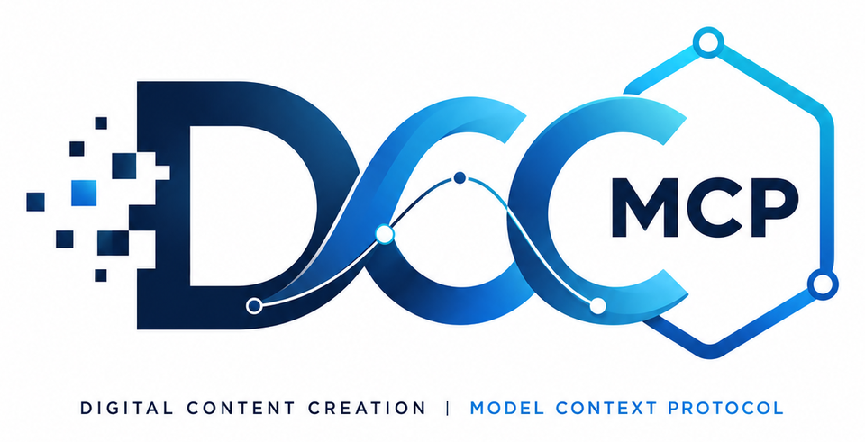
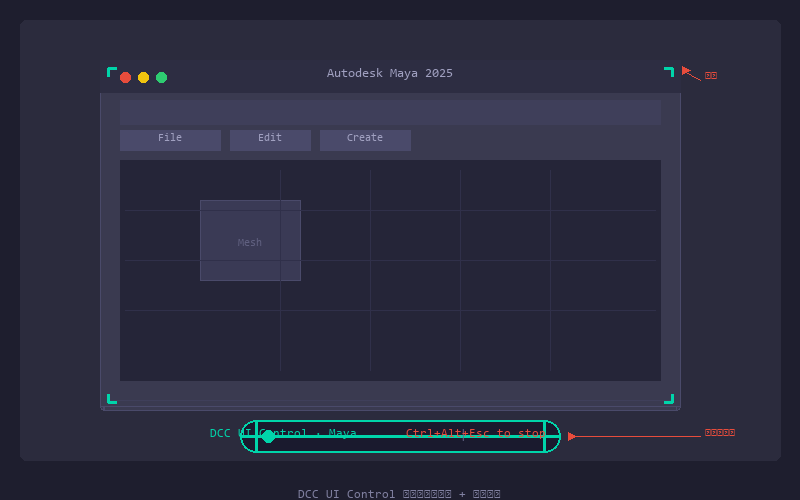
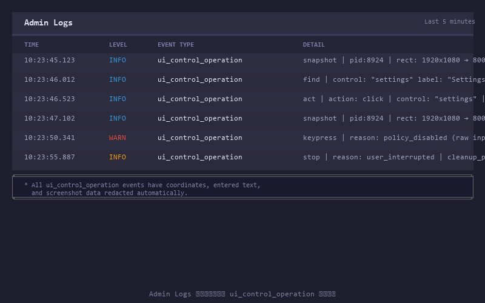
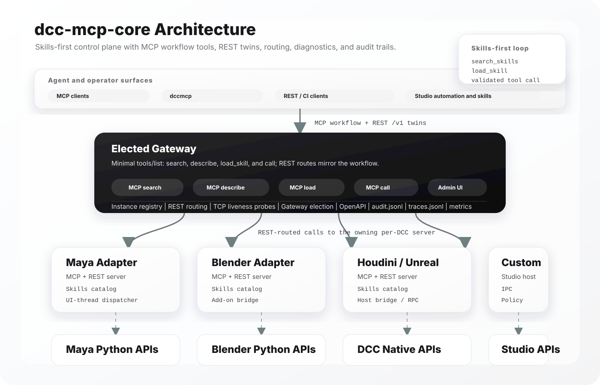

# dcc-mcp-core

[中文](README_zh.md) | English

[Website](https://dcc-mcp.github.io/) · [Marketplace](https://dcc-mcp.github.io/marketplace) · [Showcase](https://dcc-mcp.github.io/showcase) · [For Agents](https://dcc-mcp.github.io/agents) · [Ecosystem](https://dcc-mcp.github.io/ecosystem)

dcc-mcp-core turns Maya, Blender, Houdini, Photoshop, Godot, RenderDoc, and
custom studio hosts into discoverable MCP and REST capabilities. It provides
the gateway, skills, structured results, main-thread dispatch, diagnostics,
IPC, and workflows needed to operate real desktop sessions. The standalone
DCCMCP command-line control plane is released from
[`dcc-mcp/dcc-mcp-cli`](https://github.com/dcc-mcp/dcc-mcp-cli).

## Choose your entry point

| You want to… | Start with |
|---|---|
| Control a running DCC from an agent or CI job | [DCCMCP CLI](docs/guide/cli-reference.md) |
| Expose a DCC adapter over MCP/REST | [create_skill_server](docs/guide/getting-started.md) |
| Start a server from a resolved package (Rez) | [dcc-mcp-core serve](docs/guide/rez-skill-packages.md) |
| Add tools without Python registration code | [SKILL.md + tools.yaml](docs/guide/skills.md) |
| Discover and install reusable Skills | [DCC-MCP Marketplace](https://dcc-mcp.github.io/marketplace) |
| Build a new DCC adapter | [new-adapter-onboarding.md](docs/guide/new-adapter-onboarding.md) |
| Understand routing and multi-instance behavior | [gateway.md](docs/guide/gateway.md) |
| Integrate from any HTTP client | [rest-api-surface.md](docs/guide/rest-api-surface.md) |

## The current contract

The default agent path is DCCMCP CLI + REST. The primary command is `dccmcp`.
`dcc-mcp-cli` remains a compatibility alias.

~~~text
dccmcp dcc-types (when adapter support is unclear)
  -> list
  -> search
  -> describe
  -> load-skill (only when needed)
  -> call
~~~

The gateway keeps tools/list bounded. It advertises the canonical
discovery/dispatch wrappers (search, describe, load_skill, and call) instead of
fanning every backend tool into one large list. Backend capabilities are
discovered by search, inspected by describe, and invoked through the wrapper or
the REST twin (POST /v1/search, /v1/describe, /v1/call).

When a concrete DCC session is needed, read gateway://instances; each entry
already includes its mcp_url. Do not use the removed legacy instance tools
(list_dcc_instances, get_dcc_instance, or connect_to_dcc). Wrapper inputs
belong inside arguments; do not put backend fields beside tool_slug.

For direct per-DCC MCP connections, the compatibility discovery names
(search_tools, describe_tool, and call_tool) remain available where the server
exposes them. New gateway integrations should use the canonical names above.

The shared MCP client is also available for generic MCP endpoints:

~~~bash
dccmcp mcp initialize --url http://127.0.0.1:9765/mcp
dccmcp mcp tools list --url http://127.0.0.1:9765/mcp
dccmcp mcp tools call --url http://127.0.0.1:9765/mcp --name create_sphere --json '{"radius": 2.0}'
~~~

## Quick start: operate a DCC

`dccmcp` is the preferred control path for every shell-capable agent.
The installed `dcc-mcp-cli` compatibility alias accepts the same commands.
If it is missing, obtain the user's consent before installing the latest
official release:

~~~bash
# Linux/macOS
curl -fsSL https://raw.githubusercontent.com/dcc-mcp/dcc-mcp-cli/main/scripts/install-cli.sh | sh

# Windows PowerShell
powershell -ExecutionPolicy Bypass -c "irm https://raw.githubusercontent.com/dcc-mcp/dcc-mcp-cli/main/scripts/install-cli.ps1 | iex"
~~~

~~~powershell
# Windows PowerShell
Invoke-WebRequest https://raw.githubusercontent.com/dcc-mcp/dcc-mcp-core/main/scripts/install-cli.ps1 -OutFile .\install-cli.ps1
Get-Content -Raw .\install-cli.ps1
# After reviewing the file and subject to the current execution policy:
& .\install-cli.ps1
~~~

Both paths accept only the official `dcc-mcp/dcc-mcp-core` release, validate
the platform update manifest and CLI SHA-256, and leave any existing binary
untouched if validation or download fails. This is an integrity check, not a
digital signature. Never pipe a remote installer directly into a shell or
bypass the machine's script execution policy.

### Install the Agent Skill you need

The three public Skills have separate jobs. Start with `dcc-mcp` for live DCC
work; install a creator Skill only when the task reaches that boundary:

| Agent task | Public Skill | Source |
|---|---|---|
| Operate a live DCC, discover tools, or search the Marketplace | [`@loonghao/dcc-mcp`](https://clawhub.ai/loonghao/skills/dcc-mcp) | [`dcc-mcp`](https://github.com/dcc-mcp/dcc-mcp-agent-plugins/tree/main/plugins/dcc-mcp/skills/dcc-mcp) |
| Create or modernize a complete DCC-MCP adapter/runtime | [`@loonghao/dcc-mcp-creator`](https://clawhub.ai/loonghao/skills/dcc-mcp-creator) | [`dcc-mcp-creator`](https://github.com/dcc-mcp/dcc-mcp-agent-plugins/tree/main/plugins/dcc-mcp/skills/dcc-mcp-creator) |
| Create, validate, or improve a DCC-specific Skill package | [`@loonghao/dcc-mcp-skills-creator`](https://clawhub.ai/loonghao/skills/dcc-mcp-skills-creator) | [`dcc-mcp-skills-creator`](https://github.com/dcc-mcp/dcc-mcp-agent-plugins/tree/main/plugins/dcc-mcp/skills/dcc-mcp-skills-creator) |

OpenClaw installs into the active workspace by default; add `--global` only
when every local OpenClaw agent should share the Skill:

~~~bash
openclaw skills install @loonghao/dcc-mcp
openclaw skills install @loonghao/dcc-mcp-creator
openclaw skills install @loonghao/dcc-mcp-skills-creator
~~~

For a Codex-compatible project, install into the standard project Skill root:

~~~bash
npx --yes clawhub@0.23.1 install @loonghao/dcc-mcp
npx --yes clawhub@0.23.1 install @loonghao/dcc-mcp-creator
npx --yes clawhub@0.23.1 install @loonghao/dcc-mcp-skills-creator
~~~

Other Agent Skills hosts should install the same ClawHub package into their
configured Skill root. Start a new agent turn after installation. Natural DCC
requests should trigger `dcc-mcp`; hosts with explicit Skill invocation can use
`$dcc-mcp`, `$dcc-mcp-creator`, or `$dcc-mcp-skills-creator` respectively.

All three packages carry Codex `agents/openai.yaml` metadata while preserving
their DCC-MCP and ClawHub contracts. Their source, vendor manifests, immutable
versions, and publication workflows now live in
[`dcc-mcp-agent-plugins`](https://github.com/dcc-mcp/dcc-mcp-agent-plugins).
This repository does not vendor those public packages. Its top-level `skills/`
directory contains Core-owned marketplace and reference Skills. Bundled runtime
Skills remain under `python/dcc_mcp_core/skills/`.

Keep an official build current through the release manifest:

~~~bash
dccmcp update
dccmcp update check
dccmcp update apply
dccmcp --auto-update list
~~~

`dccmcp update` checks, downloads, verifies, and stages the latest CLI for the
next launch. Set `DCC_MCP_CLI_AUTO_UPDATE=true` to enable the same best-effort
behavior before ordinary commands. Update failures are warnings in automatic
mode. These commands do not update a running `dcc-mcp-server`; update that
server in its own environment.

Then discover a live capability before calling it:

~~~bash
dccmcp dcc-types
dccmcp list
dccmcp search --query "create sphere" --dcc-type maya --limit 20
dccmcp describe <tool-slug>
dccmcp call <tool-slug> --json '{"radius": 2.0}' \
  --meta-json '{"agent_context":{"session_id":"task-42"}}'
~~~

`--query "create sphere"` is compatible with released CLI builds. Builds that
contain the unified search parser also accept unquoted positional words.

`dcc-types` is an offline, catalog-backed capability query. It reports
canonical adapter identifiers and install-plan availability; `list` remains
the source of truth for live instances. The targeted `--dcc-type` form emits a
versioned decision that keeps public catalog support, package/bootstrap state,
registry registration, readiness, capability discovery, and real-host proof
separate. In particular, `live_instances: 0` does not mean zero supported or
installed applications; `live_instances: null` means the local registry
observation was unavailable.

Replace the placeholder with the slug returned by search. For remote workstations,
register a gateway profile and select it:

~~~bash
dccmcp gateway register https://workstation.example:19293 --name pcA
dccmcp gateway set pcA
dccmcp list
~~~

Use `dccmcp doctor` when startup or readiness is unclear. Open the local
Admin UI at [http://127.0.0.1:9765/admin](http://127.0.0.1:9765/admin) after the
gateway is available.

When a call fails, preserve its `request_id`, run `doctor` or a failure-filtered
`stats` query, and use gateway-owned `dcc-mcp-cli feedback`. A live adapter's
`dcc_feedback__report` is only a thin Core forwarder to the same endpoint.
Gateway-routed failures also expose a
public-safe `/v1/debug/issue-reports/<request_id>` payload for a reviewed bug
report; raw bundles must never be uploaded automatically.

After a task is accepted, agents can inspect bounded gateway evidence with
`dccmcp stats --range 24h --session-id task-42`. A zero call count means
no telemetry evidence, and direct local calls may not be represented. Feed the
result plus short task and validation summaries to the
[`review_skill_improvement` prompt](https://github.com/dcc-mcp/dcc-mcp-agent-plugins/blob/main/plugins/dcc-mcp/skills/dcc-mcp-skills-creator/prompts.yaml).
The prompt defaults to no change, prefers improving an existing skill, and
never grants authority to edit or publish outside the task scope.

## Quick start: expose skills from Python

~~~bash
pip install dcc-mcp-core
~~~

Point the server at a skill directory and start the MCP endpoint:

~~~python
import os

from dcc_mcp_core import McpHttpConfig, create_skill_server

os.environ["DCC_MCP_MAYA_SKILL_PATHS"] = "/path/to/skills"

server = create_skill_server("maya", McpHttpConfig())
handle = server.start()
print(handle.mcp_url())
~~~

Local DCC instances bind an OS-assigned port by default. The resolved URL is
registered automatically, so the gateway and CLI discover it without a
hardcoded per-instance port. Pass `port=<number>` only for an explicit fixed
listener requirement.

For manual handler registration, use McpHttpServer and ToolRegistry. For
adapter lifecycle, readiness, gateway registration, and hot reload, use
DccServerBase as described in the adapter guides.

### Start a server without adapter code

`dcc-mcp-core` is a console script, so a resolved package — Rez, venv, or pip —
can start a server directly. This is what a Rez `package.py` declares in
`tools`:

~~~bash
dcc-mcp-core info              # print the full launch contract
dcc-mcp-core serve --dcc maya  # Skills-First server on an OS-assigned port
~~~

`serve` prints the resolved MCP URL, adds `--json` for one parseable object, and
accepts `--skill-path` (repeatable) for skill directories outside
`DCC_MCP_<DCC>_SKILL_PATHS`. See
[Rez skill packages](docs/guide/rez-skill-packages.md).

## Add a skill without framework glue

The project follows the agentskills.io frontmatter contract. Put dcc-mcp-core
extensions under metadata.dcc-mcp and keep tool declarations in a sibling file:

~~~text
my-skill/
├── SKILL.md
├── tools.yaml
└── scripts/
    └── do_thing.py
~~~

~~~yaml
# SKILL.md
---
name: my-skill
description: "Does a useful Maya task. Use when the user asks for it."
metadata:
  dcc-mcp:
    dcc: maya
    tools: tools.yaml
    search-hint: "geometry, scene task"
---
~~~

~~~yaml
# tools.yaml
tools:
  - name: do_thing
    description: Do the task in the active Maya scene.
    source_file: scripts/do_thing.py
    execution: sync
    affinity: main
    annotations:
      read_only_hint: false
      destructive_hint: true
~~~

Run the same production validator used by CI with
`dccmcp lint path/to/skills`. See [Skills](docs/guide/skills.md) for schemas,
groups, dependencies, testing, and migration rules.

## DCC UI Control

Desktop application automation for cases where native DCC APIs cannot observe
or drive the interface state directly. Agents use `ui_control__snapshot`,
`ui_control__find`, `ui_control__act`, `ui_control__wait_for`,
`ui_control__recording_start`, `ui_control__recording_state`,
`ui_control__recording_stop`, and `ui_control__stop_computer_use` to observe,
find, act on, and record exact target applications.

Use UI Control as a bounded fallback, not as the default DCC integration:

- Prefer structured adapter tools for scene, asset, render, and project work.
- Use UI Control for controls that have no API, incomplete adapter coverage,
  and end-to-end GUI acceptance tests.
- Do not treat every image in an agent task as UI Control evidence. DCC-native
  captures, RenderDoc exports, ImageGen output, and video frames have different
  provenance.

### How screenshots and clicks work

`ui_control__snapshot` captures only the bound window. It preserves native
resolution until either the longest edge exceeds 1600 pixels or the image
exceeds 1.5 million pixels, then downsizes while preserving aspect ratio. A
1280×720 window stays 1280×720; a 1920×1080 window becomes 1600×900. Smaller
text and custom-drawn icons are therefore easier to recognize when the target
window is large and unobstructed.

The agent receives three complementary signals:

1. PNG pixels for visual recognition and spatial understanding.
2. A CUA accessibility tree with labels, roles, and stable element tokens when
   the application exposes them.
3. Observation metadata for the exact PID, HWND, DPI, source rectangle,
   desktop generation, session, and snapshot.

Clicks prefer a semantic `control_id`. For custom-drawn UI, screenshot-relative
coordinates are mapped back through the source rectangle and DPI. Every action
must cite the latest `snapshot_id`; the host revalidates the window, desktop,
geometry, and generation before sending input, and rejects stale observations.

Successful snapshots include `capture_provenance`, including
the backend, session, target PID/HWND, output and source dimensions, scaling,
and native capture backend. Preserve that block with screenshots used as
evidence. Older images without provenance cannot be reliably attributed to UI
Control after the fact.

### Capabilities

- **Scoped window targeting** — snapshots and actions are bound to a single
  process or window handle, never the whole desktop.
- **Multi-instance sessions** — the gateway selects the DCC `instance_id`,
  while the native host namespaces each adapter connection. Separate DCC
  instances may therefore reuse a logical `session_id` such as `default`
  without sharing capabilities or cleanup state.
- **Semantic accessibility + raw input fallback** — prefer stable semantic controls
  (button, text field, checkbox) resolved by `ui_control__find`, then fall
  back to screenshot-relative coordinates when custom-drawn controls have no
  semantic node.
- **Bounded security model** — every action is scoped by the
  adapter/operator-bound PID/HWND. Raw input is enabled inside that exact scope
  by default and can be disabled with `DCC_MCP_CUA_ALLOW_RAW_INPUT=false`.
  Hard-denied: passwords,
  authentication controls, LockApp, Windows Security, terminals, and
  credential manager windows.
- **Visible control markers** — the standalone CUA Host owns the target border,
  banner, agent cursor, and `Esc` stop affordance.
- **One shared input safety owner** — multiple exact-application sessions may
  remain active. The standalone Host serializes native input and broadcasts
  `Esc`, while ordinary stop releases only the selected session.
- **Trajectory recording** — start and stop CUA recording around the actions to
  preserve the finalized CUA artifacts and structured recording state.
- **Audit trail** — every snapshot, recording, action, wait, stop, and rejected operation
  appends a redacted `ui_control_operation` event to the shared log directory,
  visible in the Admin Logs panel without exposing entered text or screenshot
  coordinates.

### Tool reference

| Tool | Description |
|------|-------------|
| `ui_control__snapshot` | Capture a bounded PNG plus accessibility tree from the scoped application |
| `ui_control__find` | Locate semantic controls by query, role, label, or object name |
| `ui_control__act` | Perform one scoped semantic or coordinate-based action |
| `ui_control__recording_start` | Start CUA trajectory/video recording in an absolute output directory |
| `ui_control__recording_state` | Read current CUA recording state |
| `ui_control__recording_stop` | Finalize CUA recording for later rendering |
| `ui_control__wait_for` | Poll until a UI condition becomes true or times out |
| `ui_control__stop_computer_use` | Release the capsule, hotkey, and global input owner |

For detailed skill reference and agent workflows, see the
[ui-control skill](python/dcc_mcp_core/skills/ui-control/SKILL.md).

## Architecture

The runtime has four useful layers:

1. **DCC service** — owns skills and executes tools inside one DCC process.
2. **Sidecar/supervisor** — bridges host RPC, readiness, process lifetime, and
   gateway registration when an adapter uses the packaged runtime.
3. **Gateway daemon** — aggregates live instances and owns discovery, routing,
   REST, Admin UI, audit, and diagnostics.
4. **Client surfaces** — CLI, MCP clients, REST clients, and marketplace tools.

The Rust workspace and package membership are defined by the root
[Cargo.toml](Cargo.toml). The Python package is a PyO3 extension with pure
Python helpers and supports Python 3.7–3.14. Build-from-source requirements come
from [rust-toolchain.toml](rust-toolchain.toml) and package metadata; the
repository does not duplicate version or package counts in this README.

## Documentation map

- [Getting started](docs/guide/getting-started.md) — install the package and
  start a first server.
- [MCP Registry setup](docs/guide/getting-started.md#mcp-registry) — discover a
  version, start a local gateway, and verify a standard MCP client.
- [CLI reference](docs/guide/cli-reference.md) — complete operator commands and
  flags.
- [Gateway guide](docs/guide/gateway.md) — daemon, registry, routing, relay, and
  multi-instance behavior.
- [REST API surface](docs/guide/rest-api-surface.md) — request envelopes,
  tool_slug, readiness, and error contracts.
- [Skills guide](docs/guide/skills.md) — authoring, loading, validation, and
  persistence.
- [Adapter onboarding](docs/guide/new-adapter-onboarding.md) — the supported
  adapter implementation and release path.
- [Documentation index](docs/guide/INDEX.md) — the complete guide/API map.
- [AI agent guide](docs/guide/ai-agent-guide.md) and [AGENTS.md](AGENTS.md) — agent workflow
  and repository rules.

## Development

Use the repository-pinned toolchain where possible:

~~~bash
vx just install
vx just dev
vx just test
vx just test-rust
vx just lint
vx just docs-check
~~~

docs-check builds the VitePress site and catches documentation links and syntax
errors. Markdown lint runs in the docs CI workflow. See
[CONTRIBUTING.md](CONTRIBUTING.md) for coding, testing, and release rules.

## License

MIT — see [LICENSE](LICENSE).
