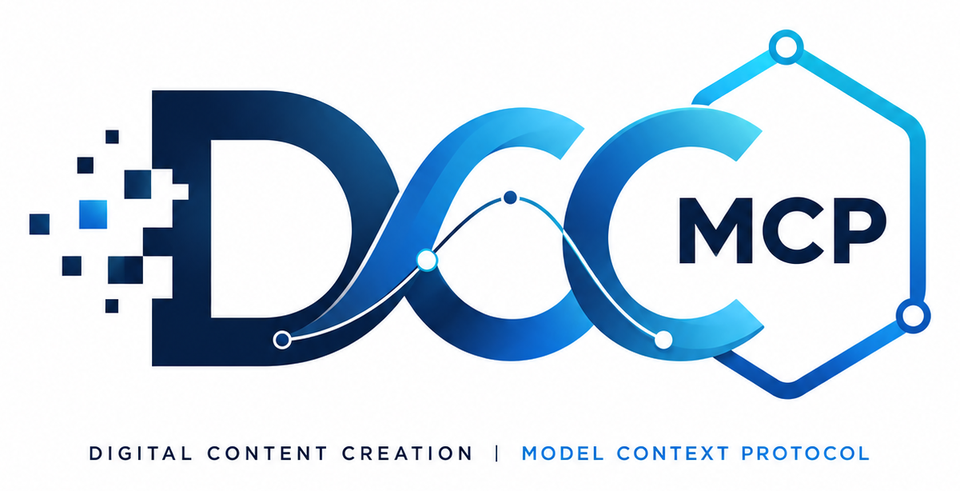
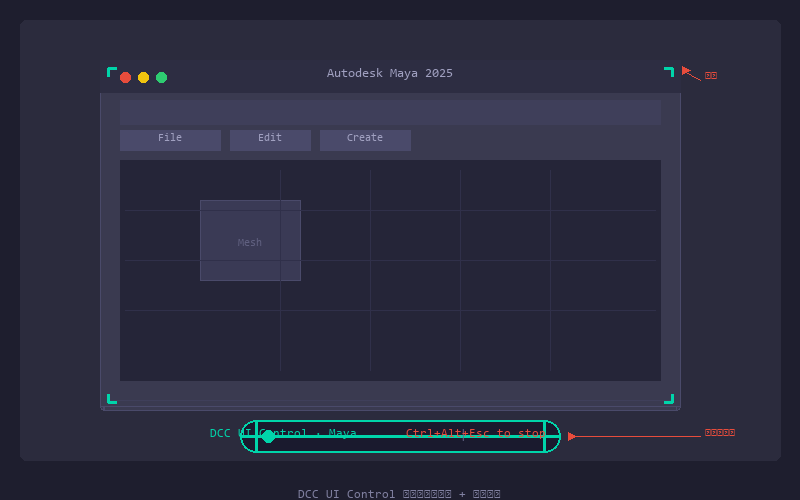
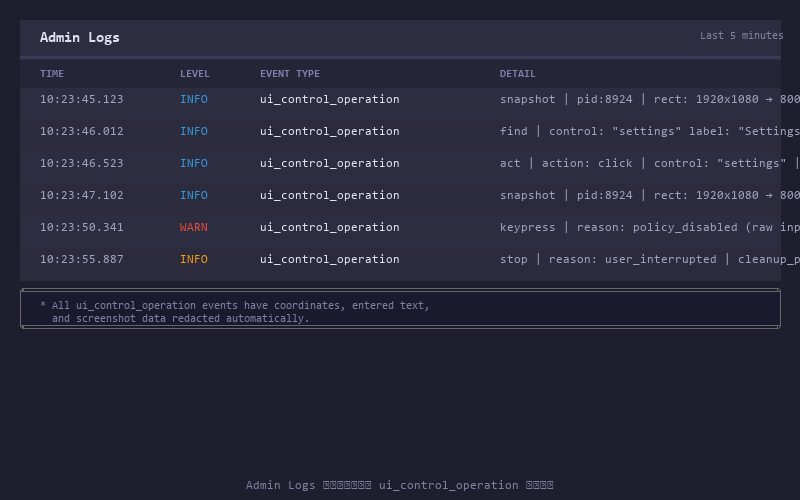

# dcc-mcp-core

[English](README.md) | [中文](README_zh.md) | Türkçe

[Web Sitesi](https://dcc-mcp.github.io/) · [Pazar Yeri](https://dcc-mcp.github.io/marketplace) · [Vitrin](https://dcc-mcp.github.io/showcase) · [Ajanlar İçin](https://dcc-mcp.github.io/agents) · [Ekosistem](https://dcc-mcp.github.io/ecosystem)

dcc-mcp-core; Maya, Blender, Houdini, Photoshop, Godot, RenderDoc ve
özel stüdyo yazılımlarını (host) keşfedilebilir MCP ve REST yeteneklerine dönüştürür. Gerçek masaüstü oturumlarını yönetmek için gereken
ağ geçidini (gateway), becerileri (skills), yapılandırılmış sonuçları, ana iş parçacığı dağıtımını, tanılamayı,
IPC'yi ve iş akışlarını sağlar. Bağımsız
DCCMCP komut satırı kontrol düzlemi
[`dcc-mcp/dcc-mcp-cli`](https://github.com/dcc-mcp/dcc-mcp-cli) üzerinden yayınlanır.

Bağdaştırıcı (adapter) kayıt defteri, desteklenen yazılımlar için tek doğruluk kaynağıdır. Aşağıdaki yeniden üretilebilir
katalog sorgusu [`dcc-mcp-catalog.yml`](dcc-mcp-catalog.yml) içinde **49 bağdaştırıcı girdisi** bildirir.
Her güncel girdi ve kurulum meta verisi için [tam oluşturulan yazılım listesine](docs/adapter-coverage.md)
bakın. Seçili yazılımlar arasında Maya, Blender,
Houdini, Photoshop, Unreal, Unity, Godot, RenderDoc ve özel stüdyo yazılımları bulunur.

~~~bash
rg -c '^    tags: \[.*"adapter".*\]' dcc-mcp-catalog.yml
~~~

Bu komut [`dcc-mcp-catalog.yml`](dcc-mcp-catalog.yml) içinde **49 bağdaştırıcı girdisi** bildirir.

## Giriş noktanızı seçin

| Yapmak istediğiniz… | Başlangıç noktası |
|---|---|
| Çalışan bir DCC'yi bir ajandan veya CI işinden kontrol etmek | [DCCMCP CLI](docs/guide/cli-reference.md) |
| Bir DCC bağdaştırıcısını MCP/REST üzerinden dışa açmak | [create_skill_server](docs/guide/getting-started.md) |
| Çözümlenmiş bir paketten (Rez) sunucu başlatmak | [dcc-mcp-core serve](docs/guide/rez-skill-packages.md) |
| Python kayıt kodu yazmadan araç eklemek | [SKILL.md + tools.yaml](docs/guide/skills.md) |
| Yeniden kullanılabilir Beceriler keşfetmek ve kurmak | [DCC-MCP Pazar Yeri](https://dcc-mcp.github.io/marketplace) |
| Yeni bir DCC bağdaştırıcısı geliştirmek | [new-adapter-onboarding.md](docs/guide/new-adapter-onboarding.md) |
| Yönlendirme ve çoklu örnek davranışını anlamak | [gateway.md](docs/guide/gateway.md) |
| Herhangi bir HTTP istemcisinden entegre etmek | [rest-api-surface.md](docs/guide/rest-api-surface.md) |

## Mevcut sözleşme

Varsayılan ajan yolu DCCMCP CLI + REST şeklindedir. Birincil komut `dccmcp` komutudur.
`dcc-mcp-cli` uyumluluk takma adı olarak kalır.

~~~text
dccmcp dcc-types (bağdaştırıcı desteği belirsiz olduğunda)
  -> list
  -> search
  -> describe
  -> load-skill (yalnızca gerektiğinde)
  -> call
~~~

Ağ geçidi `tools/list` çıktısını sınırlı tutar. Her arka uç aracını tek bir büyük listeye yaymak yerine
standart keşif/dağıtım sarmalayıcılarını (`search`, `describe`, `load_skill` ve `call`)
duyurur. Arka uç yetenekleri `search` ile keşfedilir, `describe` ile incelenir ve sarmalayıcı veya
REST eşleniği (`POST /v1/search`, `/v1/describe`, `/v1/call`) üzerinden çağrılır.

Somut bir DCC oturumu gerektiğinde `gateway://instances` kaynağını okuyun; her girdi
zaten kendi `mcp_url` değerini içerir. Kaldırılmış eski örnek araçlarını
(`list_dcc_instances`, `get_dcc_instance` veya `connect_to_dcc`) kullanmayın. Sarmalayıcı girdileri
`arguments` içine aittir; arka uç alanlarını `tool_slug` yanına koymayın.

Doğrudan DCC başına MCP bağlantıları için uyumluluk keşif adları
(`search_tools`, `describe_tool` ve `call_tool`), sunucunun bunları sunduğu yerlerde kullanılabilir olmaya devam eder.
Yeni ağ geçidi entegrasyonları yukarıdaki standart adları kullanmalıdır.

### MCP protokolü ve Agent Skills desteği

HTTP uç noktası `server/discover` üzerinden MCP `2026-07-28` sürümünü duyurur ve
resmi `io.modelcontextprotocol/skills` uzantısını sunar. Ajanlar iş akışı yönergelerini keşfetmek ve
eksiksiz SHA-256 dosya bildirimlerini doğrulamak için
`skills/list`, `skills/get`, `resources/read` ve `resources/directory/read`
çağrılarını kullanabilir. Bir beceri dosyasını okumak araçlarını etkinleştirmez.

Aynı uç nokta `2025-11-25`, `2025-06-18` ve `2025-03-26` için MCP `initialize` oturumlarını da kabul eder.
DCCMCP CLI, uyumluluk varsayılanı olarak `2025-11-25` başlatma yolunu korurken daha yeni MCP
istemcileri modern keşif yaşam döngüsünü kullanabilir.

Paylaşılan MCP istemcisi genel MCP uç noktaları için de kullanılabilir:

~~~bash
dccmcp mcp initialize --url http://127.0.0.1:9765/mcp
dccmcp mcp tools list --url http://127.0.0.1:9765/mcp
dccmcp mcp tools call --url http://127.0.0.1:9765/mcp --name create_sphere --json '{"radius": 2.0}'
~~~

## Hızlı başlangıç: bir DCC'yi yönetin

`dccmcp`, kabuk erişimi olan her ajan için tercih edilen kontrol yoludur.
Kurulu `dcc-mcp-cli` uyumluluk takma adı aynı komutları kabul eder.
Eksikse, en son resmi sürümü kurmadan önce kullanıcının onayını alın:

~~~bash
# Linux/macOS
curl -fL https://raw.githubusercontent.com/dcc-mcp/dcc-mcp-cli/main/scripts/install-cli.sh -o install-cli.sh
cat install-cli.sh
# Dosyayı inceledikten sonra:
sh ./install-cli.sh

# Windows PowerShell
Invoke-WebRequest https://raw.githubusercontent.com/dcc-mcp/dcc-mcp-cli/main/scripts/install-cli.ps1 -OutFile .\install-cli.ps1
Get-Content -Raw .\install-cli.ps1
# Dosyayı inceledikten sonra:
& .\install-cli.ps1
~~~

~~~powershell
# Windows PowerShell
Invoke-WebRequest https://raw.githubusercontent.com/dcc-mcp/dcc-mcp-cli/main/scripts/install-cli.ps1 -OutFile .\install-cli.ps1
Get-Content -Raw .\install-cli.ps1
# Dosyayı inceledikten sonra ve geçerli yürütme ilkesine tabi olarak:
& .\install-cli.ps1
~~~

Her iki yol da yalnızca resmi `dcc-mcp/dcc-mcp-cli` sürümünü kabul eder, platform güncelleme
bildirimini ve CLI SHA-256 değerini doğrular; doğrulama veya indirme başarısız olursa mevcut ikili dosyaya
dokunmaz. Bu bir bütünlük denetimidir, dijital imza değildir. Uzak bir kurucuyu asla doğrudan
kabuğa yönlendirmeyin (pipe) veya makinenin betik yürütme ilkesini atlamayın.

Windows kullanıcıları paket kullanılabilir olduğunda `winget install --id DccMcp.DccMcpCli --exact`
komutunu kullanabilir. macOS kullanıcıları ise
`brew tap dcc-mcp/tap && brew install dccmcp` komutunu kullanabilir. Her iki paket yöneticisi yolu da
bağımsız CLI deposu tarafından yayınlanır.

### İhtiyacınız olan Agent Skill'i kurun

Üç genel Beceri (Skill) ayrı görevlere sahiptir. Canlı DCC çalışmaları için `dcc-mcp` ile başlayın;
yalnızca görev o sınıra ulaştığında bir oluşturucu Beceri kurun:

| Ajan görevi | Genel Beceri | Kaynak |
|---|---|---|
| Canlı bir DCC'yi yönetmek, araç keşfetmek veya Pazar Yerinde arama yapmak | [`@loonghao/dcc-mcp`](https://clawhub.ai/loonghao/skills/dcc-mcp) | [`dcc-mcp`](https://github.com/dcc-mcp/dcc-mcp-agent-plugins/tree/main/plugins/dcc-mcp/skills/dcc-mcp) |
| Eksiksiz bir DCC-MCP bağdaştırıcısı/çalışma zamanı oluşturmak veya modernleştirmek | [`@loonghao/dcc-mcp-creator`](https://clawhub.ai/loonghao/skills/dcc-mcp-creator) | [`dcc-mcp-creator`](https://github.com/dcc-mcp/dcc-mcp-agent-plugins/tree/main/plugins/dcc-mcp/skills/dcc-mcp-creator) |
| DCC'ye özel bir Beceri paketi oluşturmak, doğrulamak veya geliştirmek | [`@loonghao/dcc-mcp-skills-creator`](https://clawhub.ai/loonghao/skills/dcc-mcp-skills-creator) | [`dcc-mcp-skills-creator`](https://github.com/dcc-mcp/dcc-mcp-agent-plugins/tree/main/plugins/dcc-mcp/skills/dcc-mcp-skills-creator) |

OpenClaw varsayılan olarak etkin çalışma alanına kurar; yalnızca her yerel OpenClaw ajanının
Beceriyi paylaşması gerektiğinde `--global` ekleyin:

~~~bash
openclaw skills install @loonghao/dcc-mcp
openclaw skills install @loonghao/dcc-mcp-creator
openclaw skills install @loonghao/dcc-mcp-skills-creator
~~~

Codex uyumlu bir proje için standart proje Beceri köküne kurun:

~~~bash
npx --yes clawhub@0.23.1 install @loonghao/dcc-mcp
npx --yes clawhub@0.23.1 install @loonghao/dcc-mcp-creator
npx --yes clawhub@0.23.1 install @loonghao/dcc-mcp-skills-creator
~~~

Diğer Agent Skills barındırıcıları aynı ClawHub paketini kendi yapılandırılmış Beceri köklerine kurmalıdır.
Kurulumdan sonra yeni bir ajan turu başlatın. Doğal DCC istekleri `dcc-mcp` becerisini tetiklemelidir;
açık Beceri çağrısı destekleyen barındırıcılar sırasıyla `$dcc-mcp`, `$dcc-mcp-creator` veya
`$dcc-mcp-skills-creator` kullanabilir.

Üç paketin tamamı DCC-MCP ve ClawHub sözleşmelerini korurken Codex `agents/openai.yaml`
meta verilerini taşır. Kaynakları, sağlayıcı bildirimleri, değişmez sürümleri ve yayın iş akışları artık
[`dcc-mcp-agent-plugins`](https://github.com/dcc-mcp/dcc-mcp-agent-plugins) içinde yer almaktadır.
Bu depo söz konusu genel paketleri kendi içine kopyalamaz (vendor etmez). Üst düzey `skills/`
dizini Core'a ait pazar yeri ve referans Becerilerini içerir. Paketlenmiş çalışma zamanı
Becerileri `python/dcc_mcp_core/skills/` altında kalır.

Resmi bir derlemeyi sürüm bildirimi üzerinden güncel tutun:

~~~bash
dccmcp update
dccmcp update check
dccmcp update apply
dccmcp --auto-update list
~~~

`dccmcp update` bir sonraki başlatma için en son CLI sürümünü kontrol eder, indirir, doğrular ve hazırlar.
Olağan komutlardan önce aynı en iyi çaba (best-effort) davranışını etkinleştirmek için
`DCC_MCP_CLI_AUTO_UPDATE=true` ayarlayın. Otomatik modda güncelleme hataları uyarı olarak gösterilir.
Bu komutlar çalışan bir `dcc-mcp-server` örneğini güncellemez; o sunucuyu kendi ortamında güncelleyin.

Ardından çağırmadan önce canlı bir yeteneği keşfedin:

~~~bash
dccmcp dcc-types
dccmcp list
dccmcp search --query "create sphere" --dcc-type maya --limit 20
dccmcp describe <tool-slug>
dccmcp call <tool-slug> --json '{"radius": 2.0}' \
  --meta-json '{"agent_context":{"session_id":"task-42"}}'
~~~

`--query "create sphere"` yayınlanmış CLI derlemeleriyle uyumludur. Birleşik arama ayrıştırıcısını
içeren derlemeler tırnaksız konumsal sözcükleri de kabul eder.

`dcc-types`, katalog destekli çevrimdışı bir yetenek sorgusudur. Standart bağdaştırıcı tanımlayıcılarını
ve kurulum planı kullanılabilirliğini bildirir; canlı örnekler için doğruluk kaynağı `list` olmaya devam eder.
Hedefli `--dcc-type` biçimi; genel katalog desteği, paket/önyükleme durumu, kayıt defteri kaydı,
hazır olma durumu, yetenek keşfi ve gerçek yazılım kanıtını ayrı tutan sürümlü bir karar üretir.
Özellikle `live_instances: 0` sıfır desteklenen veya kurulu uygulama anlamına gelmez;
`live_instances: null` ise yerel kayıt defteri gözleminin kullanılamadığı anlamına gelir.

Yer tutucuyu `search` tarafından döndürülen slug ile değiştirin. Uzak iş istasyonları için
bir ağ geçidi profili kaydedin ve seçin:

~~~bash
dccmcp gateway register https://workstation.example:19293 --name pcA
dccmcp gateway set pcA
dccmcp list
~~~

Başlatma veya hazır olma durumu belirsiz olduğunda `dccmcp doctor` kullanın. Ağ geçidi kullanılabilir
olduktan sonra [http://127.0.0.1:9765/admin](http://127.0.0.1:9765/admin) adresindeki yerel
Admin UI arayüzünü açın.

Bir çağrı başarısız olduğunda `request_id` değerini koruyun, `doctor` veya hata filtreli bir `stats`
sorgusu çalıştırın ve ağ geçidine ait `dccmcp feedback` aracını kullanın. Canlı bir bağdaştırıcının
`dcc_feedback__report` aracı aynı uç noktaya giden ince bir Core ileticisinden ibarettir.
Ağ geçidi üzerinden yönlendirilen hatalar ayrıca incelenmiş bir hata raporu için genel kullanıma güvenli
`/v1/debug/issue-reports/<request_id>` yükünü sunar; ham paketler asla otomatik olarak yüklenmemelidir.

Bir görev kabul edildikten sonra ajanlar `dccmcp stats --range 24h --session-id task-42` ile
sınırlı ağ geçidi kanıtlarını inceleyebilir. Sıfır çağrı sayısı telemetri kanıtı olmadığı anlamına gelir
ve doğrudan yerel çağrılar temsil edilmemiş olabilir. Sonucu, kısa görev ve doğrulama özetleriyle birlikte
[`review_skill_improvement` istemine](https://github.com/dcc-mcp/dcc-mcp-agent-plugins/blob/main/plugins/dcc-mcp/skills/dcc-mcp-skills-creator/prompts.yaml)
verin. İstem varsayılan olarak değişiklik yapmaz, mevcut bir beceriyi iyileştirmeyi tercih eder ve
görev kapsamı dışında düzenleme veya yayınlama yetkisi vermez.

## Hızlı başlangıç: Python'dan becerileri dışa açın

~~~bash
pip install dcc-mcp-core
~~~

Sunucuyu bir beceri dizinine yönlendirin ve MCP uç noktasını başlatın:

~~~python
import os

from dcc_mcp_core import McpHttpConfig, create_skill_server

os.environ["DCC_MCP_MAYA_SKILL_PATHS"] = "/path/to/skills"

server = create_skill_server("maya", McpHttpConfig())
handle = server.start()
print(handle.mcp_url())
~~~

Yerel DCC örnekleri varsayılan olarak işletim sistemi tarafından atanan bir porta bağlanır. Çözümlenen URL
otomatik olarak kaydedilir; böylece ağ geçidi ve CLI sabit kodlanmış örnek başına port olmadan onu keşfeder.
`port=<number>` parametresini yalnızca açık bir sabit dinleyici gereksinimi olduğunda geçirin.

Manuel işleyici kaydı için `McpHttpServer` ve `ToolRegistry` kullanın. Bağdaştırıcı yaşam döngüsü,
hazır olma durumu, ağ geçidi kaydı ve sıcak yeniden yükleme için bağdaştırıcı kılavuzlarında açıklandığı gibi
`DccServerBase` kullanın.

### Bağdaştırıcı kodu olmadan sunucu başlatma

`dcc-mcp-core` bir konsol betiğidir; bu nedenle çözümlenmiş bir paket — Rez, venv veya pip —
doğrudan bir sunucu başlatabilir. Bir Rez `package.py` dosyasının `tools` içinde bildirdiği budur:

~~~bash
dcc-mcp-core info              # tam başlatma sözleşmesini yazdır
dcc-mcp-core serve --dcc maya  # işletim sisteminin atadığı portta Skills-First sunucu
~~~

`serve` çözümlenen MCP URL'sini yazdırır, ayrıştırılabilir tek bir nesne için `--json` ekler ve
`DCC_MCP_<DCC>_SKILL_PATHS` dışındaki beceri dizinleri için `--skill-path` (tekrarlanabilir) kabul eder.
Bkz. [Rez beceri paketleri](docs/guide/rez-skill-packages.md).

## Çerçeve yapıştırıcı kodu olmadan beceri ekleyin

Proje agentskills.io frontmatter sözleşmesini izler. `dcc-mcp-core` uzantılarını
`metadata.dcc-mcp` altına koyun ve araç bildirimlerini kardeş bir dosyada tutun:

~~~text
my-skill/
├── SKILL.md
├── tools.yaml
└── scripts/
    └── do_thing.py
~~~

~~~yaml
# SKILL.md
---
name: my-skill
description: "Does a useful Maya task. Use when the user asks for it."
metadata:
  dcc-mcp:
    dcc: maya
    tools: tools.yaml
    search-hint: "geometry, scene task"
---
~~~

~~~yaml
# tools.yaml
tools:
  - name: do_thing
    description: Do the task in the active Maya scene.
    source_file: scripts/do_thing.py
    execution: sync
    affinity: main
    annotations:
      read_only_hint: false
      destructive_hint: true
~~~

CI tarafından kullanılan üretim doğrulayıcısını `dccmcp lint path/to/skills` ile çalıştırın.
Şemalar, gruplar, bağımlılıklar, test ve geçiş kuralları için [Beceriler](docs/guide/skills.md) belgesine bakın.

## DCC UI Kontrolü

Yerel DCC API'lerinin arayüz durumunu doğrudan gözlemleyemediği veya yönlendiremediği durumlar için
masaüstü uygulama otomasyonu. Ajanlar kesin hedef uygulamaları gözlemlemek, bulmak, üzerinde işlem yapmak
ve kaydetmek için `ui_control__snapshot`, `ui_control__find`, `ui_control__act`, `ui_control__wait_for`,
`ui_control__recording_start`, `ui_control__recording_state`, `ui_control__recording_stop` ve
`ui_control__stop_computer_use` araçlarını kullanır.

UI Kontrolünü varsayılan DCC entegrasyonu olarak değil, sınırlı bir yedek (fallback) olarak kullanın:

- Sahne, varlık, render ve proje işleri için yapılandırılmış bağdaştırıcı araçlarını tercih edin.
- UI Kontrolünü API'si olmayan kontroller, eksik bağdaştırıcı kapsamı ve uçtan uca GUI kabul testleri için kullanın.
- Bir ajan görevindeki her görseli UI Kontrolü kanıtı olarak değerlendirmeyin. DCC'ye özgü yakalamalar,
  RenderDoc dışa aktarımları, ImageGen çıktıları ve video kareleri farklı kaynaklara sahiptir.

### Ekran görüntüleri ve tıklamalar nasıl çalışır

`ui_control__snapshot` yalnızca bağlı pencereyi yakalar. En uzun kenar 1600 pikseli veya görsel
1,5 milyon pikseli aşana kadar yerel çözünürlüğü korur, ardından en-boy oranını koruyarak küçültür.
1280×720 bir pencere 1280×720 kalır; 1920×1080 bir pencere 1600×900 olur. Bu nedenle hedef pencere
büyük ve engelsiz olduğunda küçük metinleri ve özel çizilmiş simgeleri tanımak daha kolaydır.

Ajan üç tamamlayıcı sinyal alır:

1. Görsel tanıma ve uzamsal anlama için PNG pikselleri.
2. Uygulama bunları sunduğunda etiketler, roller ve kararlı öğe belirteçleri içeren bir CUA erişilebilirlik ağacı.
3. Kesin PID, HWND, DPI, kaynak dikdörtgen, masaüstü nesli, oturum ve anlık görüntü için gözlem meta verileri.

Tıklamalar anlamsal bir `control_id` tercih eder. Özel çizilmiş arayüzler için ekran görüntüsüne göreli
koordinatlar kaynak dikdörtgen ve DPI üzerinden geri eşlenir. Her eylem en son `snapshot_id` değerini
belirtmelidir; barındırıcı girdi göndermeden önce pencereyi, masaüstünü, geometriyi ve nesli yeniden
doğrular ve bayat gözlemleri reddeder.

Başarılı anlık görüntüler; arka uç, oturum, hedef PID/HWND, çıktı ve kaynak boyutları, ölçekleme ve
yerel yakalama arka ucu dahil `capture_provenance` bilgisini içerir. Kanıt olarak kullanılan ekran
görüntüleriyle bu bloğu koruyun. Kaynak bilgisi olmayan eski görseller sonradan UI Kontrolüne güvenilir
biçimde atfedilemez.

### Yetenekler

- **Kapsamlı pencere hedefleme** — anlık görüntüler ve eylemler tüm masaüstüne değil, tek bir sürece
  veya pencere tutamacına bağlıdır.
- **Çoklu örnek oturumları** — ağ geçidi DCC `instance_id` değerini seçerken yerel barındırıcı her
  bağdaştırıcı bağlantısını ad alanına ayırır. Bu nedenle ayrı DCC örnekleri yetenekleri veya temizleme
  durumunu paylaşmadan `default` gibi mantıksal bir `session_id` değerini yeniden kullanabilir.
- **Anlamsal erişilebilirlik + ham girdi yedeği** — `ui_control__find` tarafından çözümlenen kararlı
  anlamsal kontrolleri (düğme, metin alanı, onay kutusu) tercih edin, özel çizilmiş kontrollerde anlamsal
  düğüm olmadığında ekran görüntüsüne göreli koordinatlara geri dönün.
- **Sınırlı güvenlik modeli** — her eylem bağdaştırıcı/operatör bağlı PID/HWND ile sınırlandırılmıştır.
  Ham girdi varsayılan olarak o kesin kapsam içinde etkindir ve `DCC_MCP_CUA_ALLOW_RAW_INPUT=false` ile
  devre dışı bırakılabilir. Kesin olarak reddedilenler: parolalar, kimlik doğrulama kontrolleri, LockApp,
  Windows Güvenliği, terminaller ve kimlik bilgisi yöneticisi pencereleri.
- **Görünür kontrol işaretçileri** — bağımsız CUA Host; hedef kenarlığını, başlığı, ajan imlecini ve
  `Esc` durdurma olanağını yönetir.
- **Tek paylaşılan girdi güvenliği sahibi** — birden fazla kesin uygulama oturumu etkin kalabilir.
  Bağımsız Host yerel girdiyi sıraya koyar ve `Esc` yayınlar; normal durdurma ise yalnızca seçili oturumu
  serbest bırakır.
- **Yörünge kaydı** — sonlandırılmış CUA yapıtlarını ve yapılandırılmış kayıt durumunu korumak için
  eylemler etrafında CUA kaydını başlatın ve durdurun.
- **Denetim izi** — her anlık görüntü, kayıt, eylem, bekleme, durdurma ve reddedilen işlem, girilen metin
  veya ekran görüntüsü koordinatlarını açığa çıkarmadan Admin Logs panelinde görülebilen paylaşılan günlük
  dizinine sansürlenmiş bir `ui_control_operation` olayı ekler.

### Araç başvurusu

| Araç | Açıklama |
|------|----------|
| `ui_control__snapshot` | Kapsamlı uygulamadan sınırlı bir PNG ve erişilebilirlik ağacı yakala |
| `ui_control__find` | Sorgu, rol, etiket veya nesne adına göre anlamsal kontrolleri bul |
| `ui_control__act` | Kapsamlı tek bir anlamsal veya koordinat tabanlı eylem gerçekleştir |
| `ui_control__recording_start` | Mutlak bir çıktı dizininde CUA yörünge/video kaydını başlat |
| `ui_control__recording_state` | Geçerli CUA kayıt durumunu oku |
| `ui_control__recording_stop` | Daha sonra işlemek üzere CUA kaydını sonlandır |
| `ui_control__wait_for` | Bir UI koşulu doğru olana veya zaman aşımına uğrayana kadar yokla |
| `ui_control__stop_computer_use` | Kapsülü, kısayol tuşunu ve genel girdi sahibini serbest bırak |

Ayrıntılı beceri başvurusu ve ajan iş akışları için
[ui-control becerisine](python/dcc_mcp_core/skills/ui-control/SKILL.md) bakın.

## Mimari

Çalışma zamanının dört kullanışlı katmanı vardır:

1. **DCC servisi** — becerilere sahip olur ve araçları tek bir DCC süreci içinde yürütür.
2. **Sidecar/gözetmen (supervisor)** — bir bağdaştırıcı paketlenmiş çalışma zamanını kullandığında barındırıcı
   RPC, hazır olma durumu, süreç yaşam süresi ve ağ geçidi kaydı arasında köprü kurar.
3. **Ağ geçidi arka plan programı (daemon)** — canlı örnekleri toplar ve keşif, yönlendirme, REST,
   Admin UI, denetim ve tanılamaya sahip olur.
4. **İstemci yüzeyleri** — CLI, MCP istemcileri, REST istemcileri ve pazar yeri araçları.

Rust çalışma alanı ve paket üyeliği kök [Cargo.toml](Cargo.toml) tarafından tanımlanır. Python paketi
saf Python yardımcılarına sahip bir PyO3 uzantısıdır ve Python 3.7–3.14 sürümlerini destekler. Kaynaktan
derleme gereksinimleri [rust-toolchain.toml](rust-toolchain.toml) ve paket meta verilerinden gelir; depo
bu README'de sürüm veya paket sayılarını yinelemez.

## Belge haritası

- [Başlangıç](docs/guide/getting-started.md) — paketi kurun ve ilk sunucuyu başlatın.
- [MCP Registry kurulumu](docs/guide/getting-started.md#mcp-registry) — bir sürüm keşfedin, yerel bir
  ağ geçidi başlatın ve standart bir MCP istemcisini doğrulayın.
- [CLI başvurusu](docs/guide/cli-reference.md) — eksiksiz operatör komutları ve bayrakları.
- [Ağ geçidi kılavuzu](docs/guide/gateway.md) — arka plan programı, kayıt defteri, yönlendirme, aktarım
  ve çoklu örnek davranışı.
- [REST API yüzeyi](docs/guide/rest-api-surface.md) — istek zarfları, `tool_slug`, hazır olma durumu ve
  hata sözleşmeleri.
- [Beceriler kılavuzu](docs/guide/skills.md) — yazma, yükleme, doğrulama ve kalıcılık.
- [Bağdaştırıcı katılımı](docs/guide/new-adapter-onboarding.md) — desteklenen bağdaştırıcı uygulama ve
  yayınlama yolu.
- [Belge dizini](docs/guide/INDEX.md) — eksiksiz kılavuz/API haritası.
- [AGENTS.md](AGENTS.md) ve [agents-reference.md](docs/guide/agents-reference.md) — ajan iş akışı ve
  depo kuralları.

## Geliştirme

Mümkün olduğunda deponun sabitlediği araç zincirini kullanın:

~~~bash
vx just install
vx just dev
vx just test
vx just test-rust
vx just lint
vx just docs-check
~~~

`docs-check` VitePress sitesini derler ve belge bağlantılarını ile sözdizimi hatalarını yakalar.
Markdown lint denetimi docs CI iş akışında çalışır. Kodlama, test ve yayınlama kuralları için
[CONTRIBUTING.md](CONTRIBUTING.md) dosyasına bakın.

## Lisans

MIT — bkz. [LICENSE](LICENSE).
